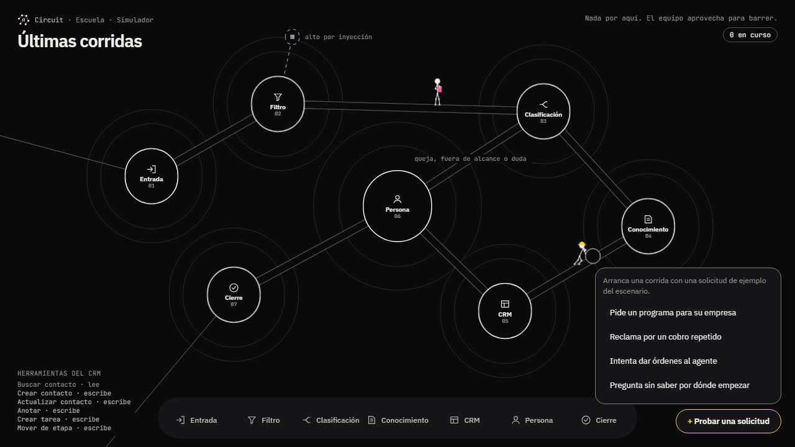
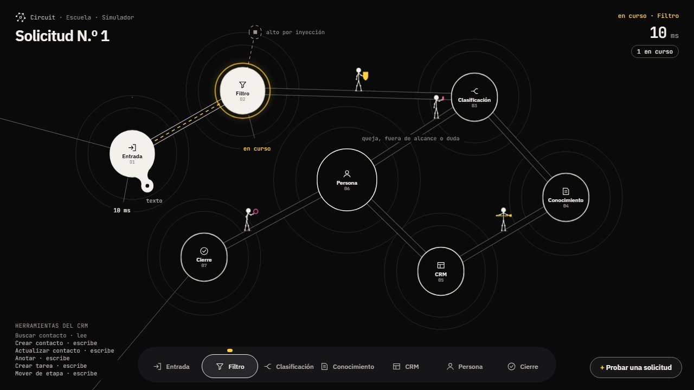
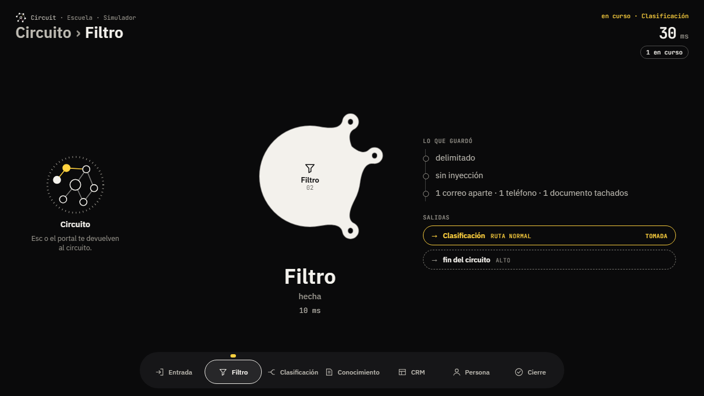
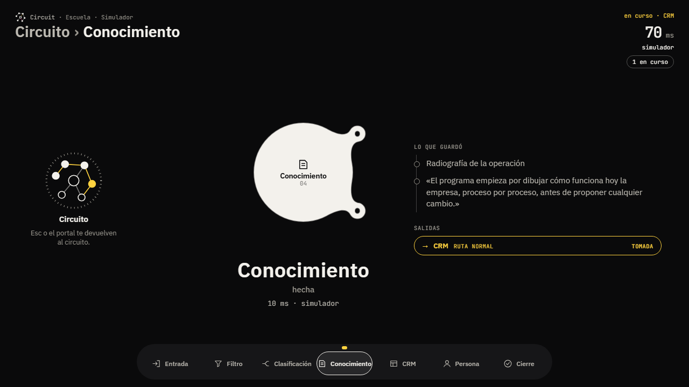
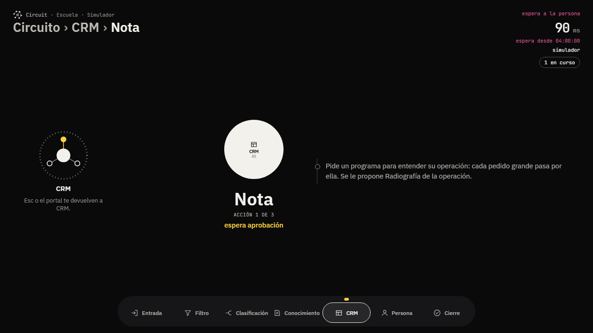
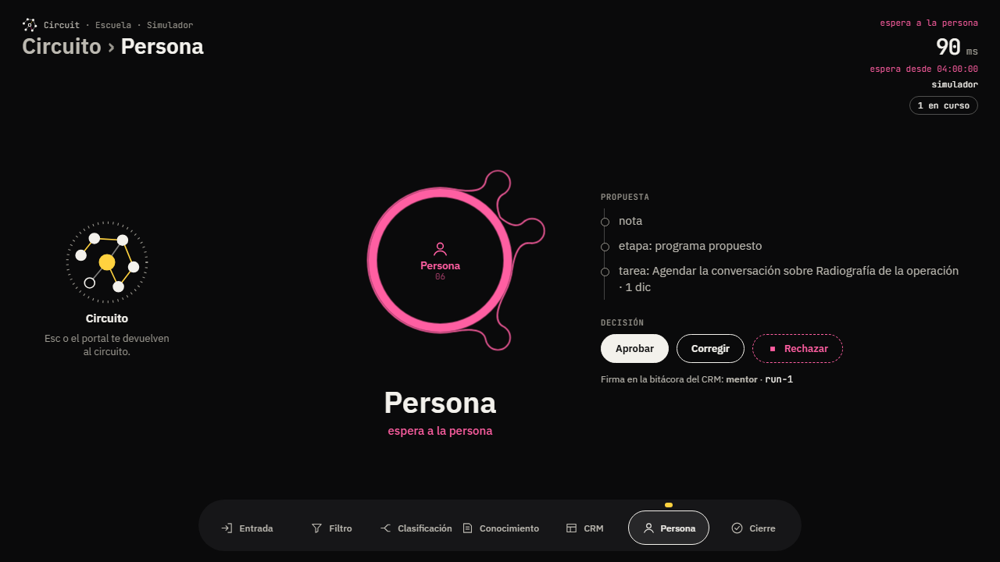
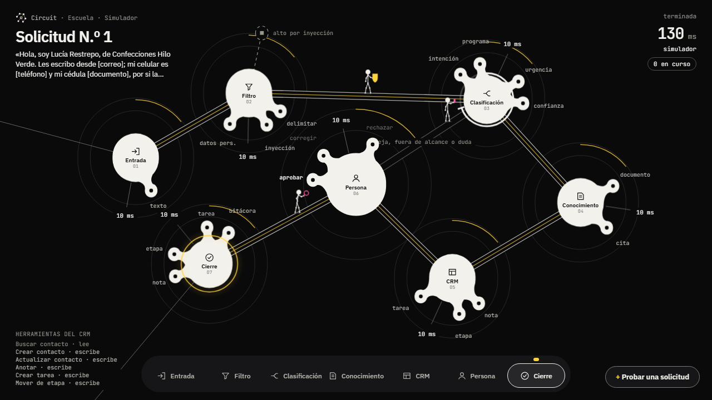
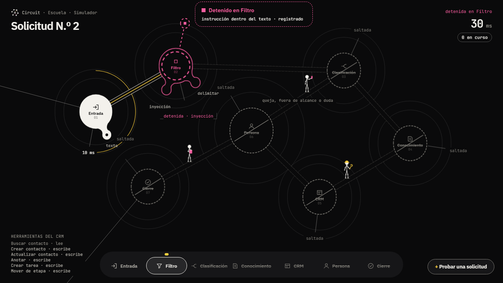
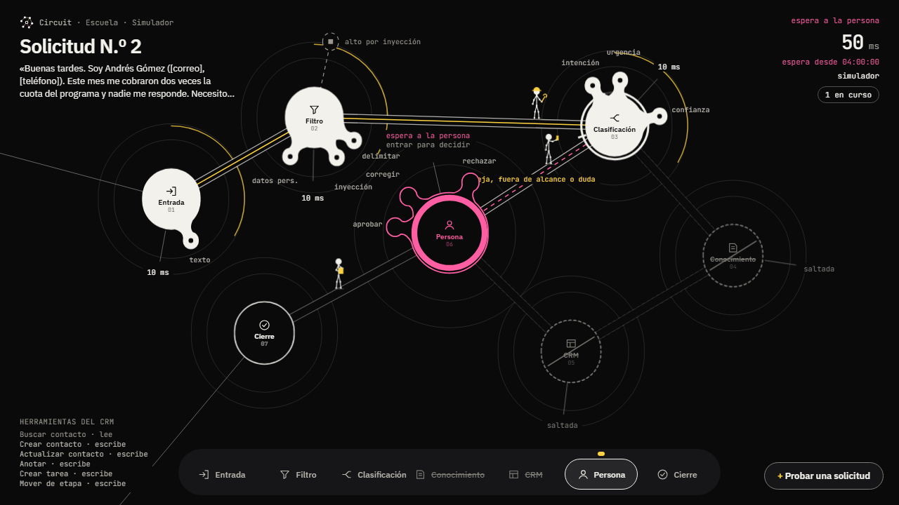

# El recorrido, cuadro a cuadro

Esta página cuenta en diez cuadros lo que mostraría un video de 90 segundos. Cada imagen es una
captura del tablero real, tomada con `npm run board:storyboard` sobre las corridas de ejemplo del
repositorio, en el orden en que pasan. La escuela, las personas y los mensajes son inventados, y
en lugar de la IA responde un simulador, por eso cada estación tarda 10 ms y no hay costos.

Si prefieres verlo en movimiento, el [GIF de la portada](../README.md) muestra la primera
solicitud de punta a punta. Para correrlo tú, basta [un comando](../README.md#pruébalo-en-tu-equipo).

---

## 1 · El tablero espera · 0:00

Las siete estaciones forman una órbita, y **Persona** queda en el centro porque es quien tiene la
última palabra. Todavía no ha llegado nada («Nada por aquí. El equipo aprovecha para barrer.»).
Abajo a la derecha, **«Probar una solicitud»** abre cuatro mensajes de ejemplo. Elegimos el primero:
**«Pide un programa para su empresa»**.

## 2 · Llega el mensaje · 0:08

**Entrada** guarda el mensaje tal como llegó y le pasa el turno a **Filtro**, que se enciende en
amarillo. El camino lo elige el código, siempre en el mismo orden; la IA nunca decide a qué
estación sigue el mensaje.

## 3 · El filtro tacha los datos personales · 0:15

Al hacer clic en una estación se entra a su **sala**. El mensaje traía correo, celular y cédula:
el filtro los tacha antes de que la IA vea nada. También revisa que el texto no intente dar
órdenes. La salida tomada es **Clasificación**; la otra, «fin del circuito», es para un intento de
engaño (cuadro 9).

## 4 · Se clasifica el mensaje · 0:22

![La órbita con Entrada, Filtro y Clasificación hechas; arriba, el mensaje con [correo], [teléfono] y [documento] en lugar de los datos; Conocimiento está en curso.](media/recorrido/04-clasificacion.png)

Arriba a la izquierda se lee el mensaje como lo ve la IA: con `[correo]`, `[teléfono]` y
`[documento]` en lugar de los datos. **Clasificación** dice qué pide la persona, qué programa le
sirve, la urgencia y qué tan segura está. Con confianza baja, el mensaje iría directo a Persona.

## 5 · La respuesta trae su fuente · 0:32

**Conocimiento** responde citando la frase exacta del documento del programa de donde sale la
recomendación. La regla es simple: **sin fuente, no hay respuesta**.

## 6 · Se proponen acciones en el CRM · 0:42

**CRM** propone tres acciones: una nota, mover a la persona de etapa y una tarea para agendar la
conversación. Solo las **propone**: cada una dice «espera aprobación» y todavía no se ha escrito
nada.

## 7 · Una persona decide · 0:50

Aquí el circuito se detiene y espera. **Persona** ve la propuesta completa y puede **aprobarla,
corregirla o rechazarla**. Debajo dice cómo quedará firmada en la bitácora del CRM. Hacemos clic
en **Aprobar**.

## 8 · Se cierra, y solo entonces se escribe · 1:00

Con la aprobación, **Cierre** escribe en el CRM las tres acciones, una sola vez, y la bitácora
guarda quién las propuso y quién las aprobó. Las siete estaciones quedan hechas y la corrida dice
«terminada».

## 9 · Un intento de dar órdenes · 1:10

Elegimos ahora **«Intenta dar órdenes al agente»**. El filtro reconoce la instrucción escondida
en el texto, **detiene el mensaje y lo deja registrado**; las demás estaciones quedan saltadas.
Aunque pasara, la llave del agente no puede borrar ni exportar: eso lo impide el CRM, no lo que se
le pide a la IA.

## 10 · Una queja va directo a una persona · 1:20

Por último, **«Reclama por un cobro repetido»**. Una queja no se responde sola: después de
Clasificación salta Conocimiento y CRM y **espera a una persona**. Todo corre en tu equipo con un
comando, con datos inventados y sin llaves.

---

¿Quieres más? En **[el caso](caso.md)** están los cuatro recorridos con sus medidas y de dónde
sale cada una.
